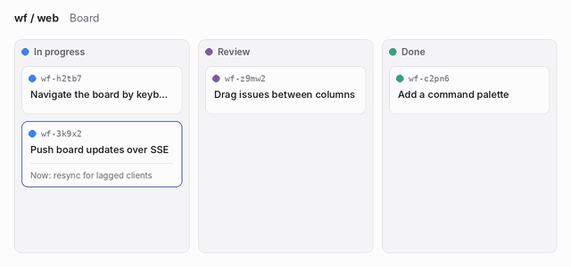

A cold agent has no memory of the last session. On the board it meets an issue as a card, and the card is the cheapest thing it can read. This note is about what the card has to say.

## What travels with the card

The Now line is the `summary` of `current_state.md`: one sentence in the present tense, 120 characters at most. When the card changes column the line does not change, so it has to stay true after the move.

> [!TIP]
> Write the Now line so that it is true in both columns. "Delta stream runs end to end; lagged-client resync is in flight" holds in In progress and in Review. "Waiting for review" does not.

## What a cold agent reads, in order

1. The goal and the criteria: what done means.
2. The Now line and the next steps of `current_state.md`: where work stopped and what to do.
3. Open requests to a person: what it must not decide alone.
4. The last five log entries: what was tried.
5. Linked library items: the rules that apply.

The goal, the criteria and the current state are never cut from a bundle. The rest is cut from the bottom of the list when the budget runs out, so the order above is also the order of what survives.

## What to try next

- Trim the log by kind when the budget cuts. Keep decisions and failed attempts, and drop routine progress entries first.
- Keep the failed attempts in `current_state.md`, which is never cut. A cold agent repeats them otherwise.
- Measure before changing the size: see [[topics/agent-context/bundle-sizes]].
