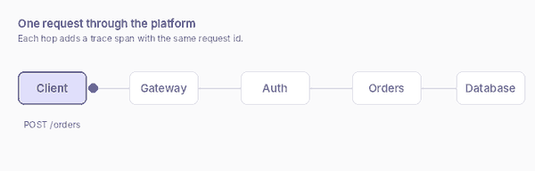

# Service topology

Who calls whom, and who owns what.



## The services

| Service   | Owns                             | Calls             | On call     |
| --------- | -------------------------------- | ----------------- | ----------- |
| `gateway` | Routing, rate limits, TLS        | `auth`, `orders`  | Platform    |
| `auth`    | Sign-in, tokens, the signing key | Identity provider | Platform    |
| `orders`  | Orders and their database        | Payments API      | Orders team |

## Rules for calls

- Services call each other over the internal network with a service token, never with a user's token.
- A call that waits longer than 2 seconds is cut off and retried once.
- The only service the internet reaches is `gateway`.

```yaml
# The route table in the gateway, abridged
routes:
  - path: /orders
    service: orders
    auth: required
  - path: /login
    service: auth
    auth: none
```

> [!IMPORTANT]
> Adding a service means adding a page here and a runbook in [[runbooks]]. A service without both is not allowed in production.

See [[architecture/request-lifecycle]] for what happens inside one call.
